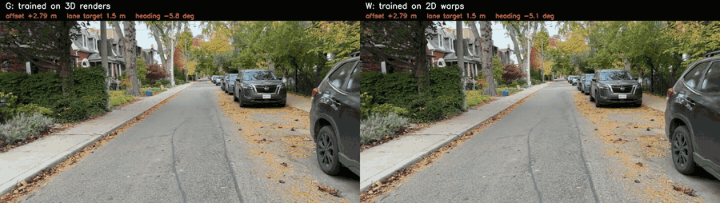
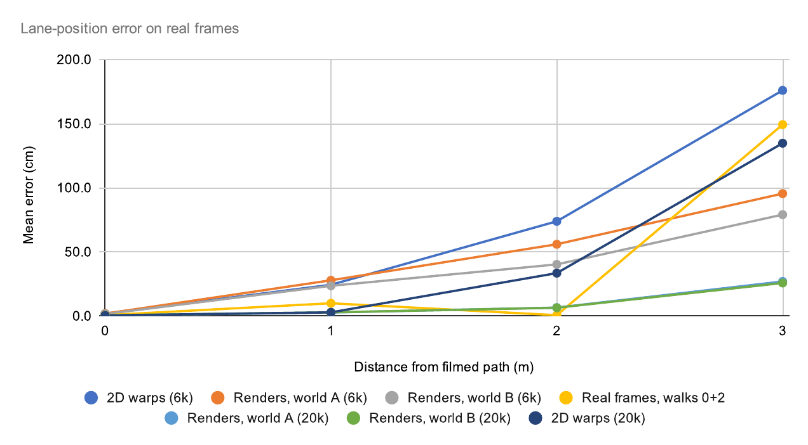
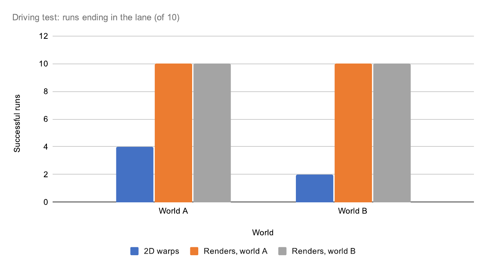
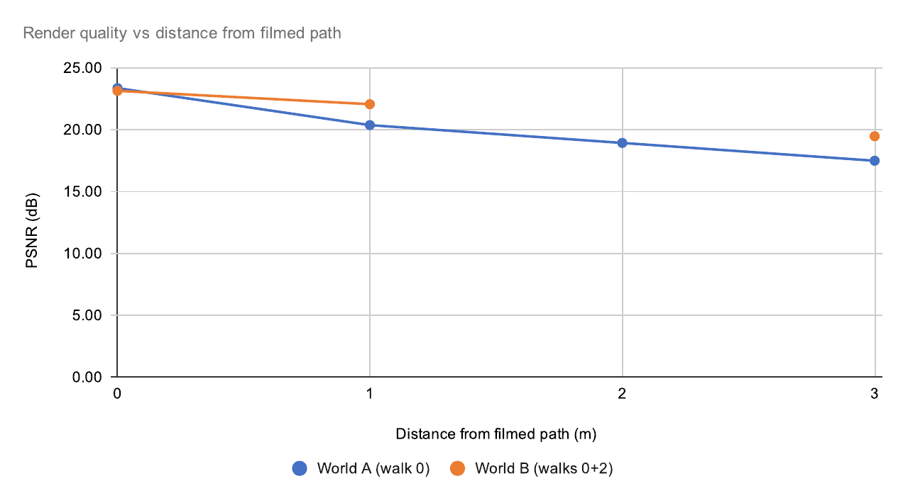

# splat2lane

Can a lane keeping network handle views it hasn't seen if it's trained inside a 3D reconstruction?



*Left, trained on 3D renders. Right, trained on 2D warps. Both start off to the side and steer back toward the lane.*

A 30 second video of the project is [here](results/media/splat2lane_demo.mp4). Every number and check behind this page is in [RESULTS.md](RESULTS.md).

## the idea

A self driving car's camera has to know how far the car is from its lane. To learn that, the network needs images from positions where the car has drifted sideways, which are rarely filmed, so they're usually generated.

NVIDIA's approach (PilotNet) shifts real frames with 2D warps. It's simple, but it treats the scene as flat, so near and far objects move incorrectly. My approach builds a 3D Gaussian splat of the street and renders new views from any position.

To compare them, I filmed real walks to the side of the original path as ground truth, trained the same network on each kind of generated image and tested it on those real frames.

## main result

Three metres from the filmed path, the network trained on 3D renders has an average error of **27 cm**, against **135 cm** when trained on 2D warps with the same amount of data.

**So training on 3D renders gives about 5x lower error than NVIDIA's 2D warps.**

Error on real frames vs distance from the filmed path, lower is better.



## 3D world and video

- **3D.** You can explore the whole street in your browser [in SuperSplat](https://superspl.at/editor?load=https://huggingface.co/datasets/mohsem/splat2lane-street/resolve/main/street.compressed.ply) (3.03M gaussians, compressed to 177 MB, so it takes a minute to load). The file is on [Hugging Face](https://huggingface.co/datasets/mohsem/splat2lane-street) since it's too large for git.
- **Video.** Closed loop replayed in the big splat world, with the render network on the left and the warp network on the right. The clip at the top is a smaller version of [`results/media/demo_small.mp4`](results/media/demo_small.mp4).

## how it works

1. **Filming.** Robert St, Toronto, Wed 28 Oct. iPhone at 4K 30 fps with exposure, focus and white balance locked. Four parallel walks at 0, 1, 2 and 3 m from the curb line, with a slower repeat of walk 0 and a sideways sweep that connects them. COLMAP puts the walks at **0.03 / 0.93 / 1.93 / 3.07 m**.
2. **Camera poses.** 878 frames, all posed. A single forward walk can't be posed on its own because the viewing angles between frames are too small (a 61 frame test clip registered 2 frames), so the side walks and the sweep are what make the reconstruction possible.
3. **3D worlds.** nerfstudio `splatfacto`, 30k iterations on an RTX 3080. World A uses walk 0 frames only, so walks 1-3 are never seen. World B uses walks 0 and 2. G and G2 are the networks trained on renders from A and B. A larger world built from all walks is only used for the video and the viewer.
4. **Generating training data.** The world is rendered at a random position along walk 0, offset 0 to 3 m and heading −10° to 15°. The label is the camera pose used for the render, and 6,000 views take about 70 s.
5. **Lane network.** An ImageNet pretrained ResNet18 predicts offset and heading, with the same loss, optimizer and schedule for every training set. Every set includes the real walk 0 frames. W is the 2D warp baseline, and R uses only real frames from walks 0 and 2 (the option of filming more).
6. **Test on real frames.** The labels are the COLMAP offsets and headings of every real frame of walks 0-3, undistorted to match the renders.
7. **Closed loop**, inside the splat. At each step the network sees a render, predicts its position, steers and moves 0.5 m, over 20 m from 10 starts per network per world. A run succeeds if it ends within 30 cm of the target.

## results

**Offset error on real frames, MAE in cm** (mean ± std over 3 seeds, sources in [RESULTS.md](RESULTS.md))

| network | trained on | 0 m | 0.93 m | 1.93 m | 3.07 m |
|---|---|---|---|---|---|
| **W** | 2D warps (6k) | 2.0 ± 0.5 | 24.4 ± 2.0 | 73.9 ± 8.3 | **176.0 ± 9.8** |
| G | world A renders (6k) | 1.9 ± 0.2 | 27.9 ± 2.7 | 56.0 ± 5.4 | 95.5 ± 10.3 |
| **G2** | world B renders (6k) | 1.6 ± 0.2 | 23.6 ± 9.8 | 40.3 ± 10.4* | **79.1 ± 14.2** |
| R | real walks 0 and 2 | 0.7 ± 0.1 | 10.0 ± 1.2 | 0.7 ± 0.1* | 149.3 ± 5.1 |
| W_20k | 2D warps (20k, 30 ep) | 0.5 ± 0.0 | 2.9 ± 1.6 | 33.5 ± 10.7 | 134.8 ± 9.2 |
| G_20k | world A renders (20k, 30 ep) | 0.5 ± 0.1 | 2.8 ± 0.9 | 6.6 ± 0.5 | 27.0 ± 1.7 |
| G2_20k | world B renders (20k, 30 ep) | 0.6 ± 0.1 | 2.9 ± 0.8 | 6.5 ± 1.4* | 25.8 ± 4.4 |

\* Not held out, world B and R trained on walk 2.

**So R is very accurate where it was filmed but degrades quickly beyond it (149 cm at 3 m). Filming more helps near the filmed walks, but at 3 m every render network is more accurate.**

**Closed loop** (10 starts per network per world, `results/closed_loop_summary.csv`, `results/cl_road_summary.csv`)

| target | world | W (2D warps) | G | G2 |
|---|---|---|---|---|
| walk 0 line (0 m) | A | 0/10 | 10/10 | 10/10 |
| walk 0 line (0 m) | B | 0/10 | 10/10 | 10/10 |
| in the road (1.5 m) | A | 4/10 | 10/10 | 10/10 |
| in the road (1.5 m) | B | 2/10 | 10/10 | 10/10 |

**So both render networks returned to the lane in every run (40/40 each), while the warp network succeeded in 6/40.** The loop runs inside a splat and G trained on splat images, so the real frame table above is the fair comparison.

Runs ending in the lane (target 1.5 m, out of 10), higher is better.



**Render quality.** World A loses ~7 dB of PSNR going from the filmed path to 3 m. Adding the walk at 2 m (world B) gains 1.7 dB at the unseen 1 m and 2.0 dB at the unseen 3 m.

**So render quality drops with distance from the filmed path, and one extra walk noticeably improves the unfilmed views.**

Render quality (PSNR) vs distance, higher is better.



**Half street.** I built a world from the first half of the street only and tested on real frames from the second half. Near the path it generalizes well, but at 3 m its error is 3.3x higher than the network trained on the whole street, though still about 1.9x lower than W. **So generalizing to new streets at larger offsets probably needs worlds from more than one street.**

## limitations

- All data comes from one street filmed in a single late morning, so I haven't tested other weather, lighting or streets.
- The footage was filmed walking with the phone at chest height, while a car camera sits at a different height and moves much faster.
- The offsets come from COLMAP and not a tape measure, and the scale is fitted so the walk spacing matches the planned 1/2/3 m.
- The side walks helped build the shared camera map, and `choose_world.py` picks the world using walks 1 and 3, so this isn't an untouched test set. The fix is a separate validation split.
- World B and R saw walk 2, so their 1.93 m numbers aren't held out (marked *).

My next step is a small robot car with a camera, so the network drives in the real world using only what it learned inside the reconstruction from my phone video.

## prior art

- **PilotNet** ([NVIDIA, 2020](https://arxiv.org/pdf/2010.08776)) trained steering on off centre views made by 2D warps under a flat world assumption. That's baseline W here. It was never compared against 3D renders with real off path ground truth.
- **HUGSIM** ([2024](https://arxiv.org/abs/2412.01718)) and **RAD** ([Horizon Robotics, 2025](https://arxiv.org/abs/2502.13144)) drive in 3DGS worlds built from large multi camera car datasets.
- **Para-Lane** ([3DV 2025](https://arxiv.org/abs/2502.15635)) and **EUVS** ([ICCV 2025](https://openaccess.thecvf.com/content/ICCV2025/papers/Han_Extrapolated_Urban_View_Synthesis_Benchmark_ICCV_2025_paper.pdf)) measure how 3DGS quality degrades with sideways camera shifts, using car rig data. This project uses a phone instead, and asks how that degradation affects a model trained on the renders.

The full list of sources is in [RESULTS.md](RESULTS.md).

## how to run it

A fresh clone has the scripts and the recorded results, but not the original videos, poses, training images or checkpoints. The scripts expect a prepared workspace with `frames3/`, `proc3/`, `lane/real_labels.csv` and the reconstruction outputs. Copy the Python files from `scripts/`, `train/` and `eval/` into it and run them inside the nerfstudio container with an NVIDIA GPU.

With the data prepared, these commands train the matched pair from the main result (W_20k and G_20k, 20,000 images and 30 epochs each) and evaluate it.

```bash
NAME=W_20k WARPS=lane/warps_W20k python train_offset.py W 30
NAME=G_20k RENDERS=lane/renders_G20k python train_offset.py G 30
python eval_variants.py comparison W_20k=W_20k G_20k=G_20k
```

Each command trains one seed, so repeat with `SEED=1` and `SEED=2` under different names to measure variation. The `pipeline/` scripts are the exact job chains behind every number here, and [RESULTS.md](RESULTS.md) maps each stage and lists what's missing from the repo.
