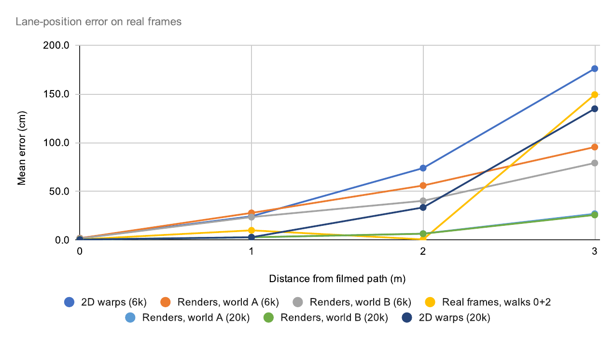
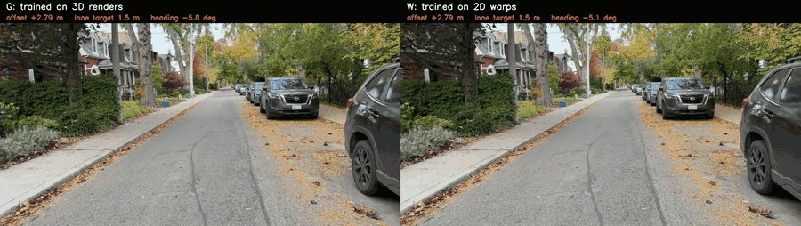
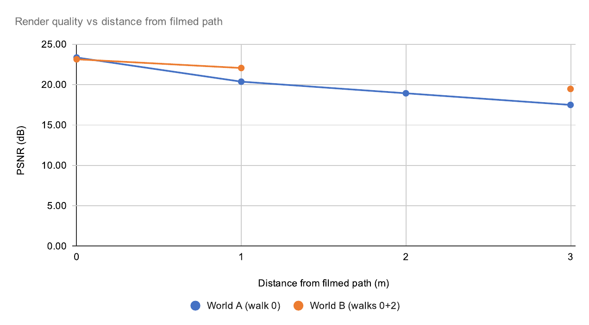
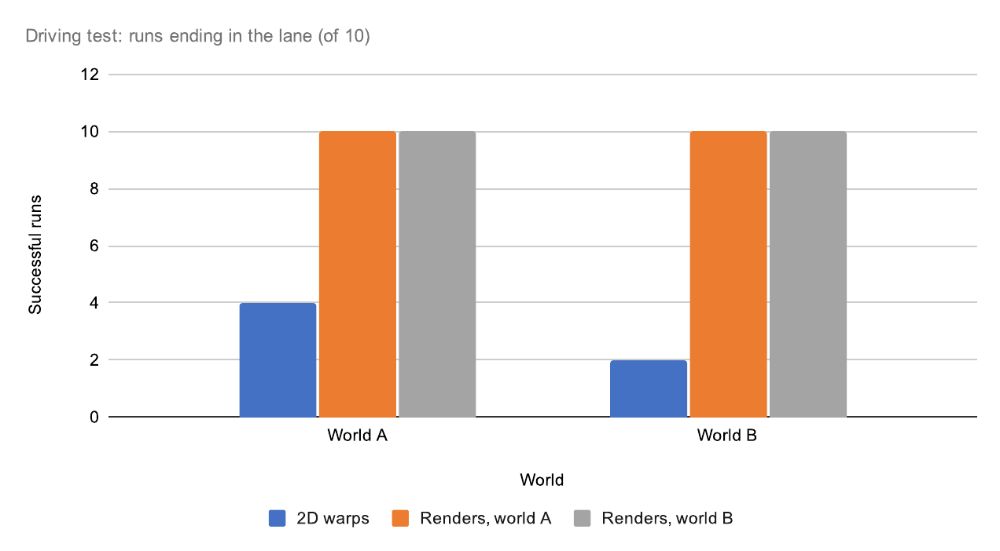

# splat2lane

Can a lane keeping net learn views nobody filmed if you train it inside a 3D copy of the street made from one phone video?

## the idea

A self driving camera has to know how far it is from the line it should be on. To learn that it needs pictures from spots where the car has drifted sideways, and nobody wants to film a car drifting. So people fake them.

NVIDIA's way (PilotNet) is to take a normal frame and warp it in 2D so it looks shifted. It's cheap but the image is flat, so close stuff and far stuff move wrong. I call that W.

My way is to turn a phone walk down the street into a 3D gaussian splat and render new pictures from wherever I want. That's G (world built from walk 0 only) and G2 (walks 0 and 2).

To check who's right I filmed real walks 1, 2 and 3 m to the side of the first one. Those are the answer key. I trained the same small net (resnet18) on each kind of fake picture and then tested it on the real side frames.

## tl;dr

On real footage 3 m off the filmed path, the net trained on 6,000 splat renders from walks 0 + 2 (G2) is off by **79.1 ± 14.2 cm**. The same net trained on 6,000 PilotNet style warps (W) is off by **176.0 ± 9.8 cm**. With 20,000 images and 30 epochs each, renders get to **27.0 ± 1.7 cm** (G_20k) and warps only to **134.8 ± 9.2 cm** (W_20k). Everything is mean ± std over 3 seeds.

**So with the same amount of data, training on the 3D renders makes the net about 5x more accurate than NVIDIA's 2D warps (27 cm vs 135 cm off at 3 m).**

Error on real frames vs distance from the filmed path, lower is better.

## 3D world and video

- **3D.** `exports/street_all_1080b/splat_yup.ply` (3.03M gaussians, 751 MB, y-up for SuperSplat). Not in git, `*.ply` is ignored. SuperSplat link coming.
- **Video.** Closed loop replayed in the big splat world, render net on the left vs warp net on the right, both starting 2.8 m off with the lane target in the road (1.5 m). Watch where each one ends up. Full quality clip in [`results/media/demo_small.mp4`](results/media/demo_small.mp4).

## how it works

1. **Filming** ([capture/PROTOCOL.md](capture/PROTOCOL.md)). Robert St, Toronto, Wed 28 Oct. iPhone at 4K 30 fps with exposure, focus and white balance locked and stabilisation off. Four parallel walks at 0, 1, 2 and 3 m from the curb line, plus a slow repeat of walk 0 and a 25 s sidestep sweep that ties them together. COLMAP puts the walks at **0.03 / 0.93 / 1.93 / 3.07 m**.
2. **Camera poses** (`pipeline/s3d_poses.sh`). 878 frames at 3 fps, 2560 wide. `ns-process-data` with vocab tree matching (16 min) plus COLMAP's incremental mapper (74 min on CPU). **All 878 frames posed.** One forward walk can't be posed on its own because the triangulation angles are too small (a 61 frame test clip registered 2 frames). The side walks and the sweep are what make the map work. The mapper uses a relaxed start (`pipeline/colmap_relaxed.sh`).
3. **3D worlds** (nerfstudio `splatfacto`, 30k iterations, RTX 3080 10 GB).
   - **World A**, walk 0 frames only (330 train frames, 1440p, 35 min). This is the honest one, walks 1-3 are never seen.
   - **World B**, walks 0 + 2 (457 train frames, 35 min).
   - **Big world**, `splatfacto-big` on all walks at 1080p (45 min), only used for the video and the viewer.
4. **Render quality off the path** (`eval/metrics_by_offset.py`, held out frames, PSNR in dB).

   | world | w0 (0 m) | w0b (0 m) | w1 (0.93 m) | w2 (1.93 m) | w3 (3.07 m) |
   |---|---|---|---|---|---|
   | A (walk 0) | 23.36 | 24.89 | 20.37 | 18.93 | 17.49 |
   | B (walks 0 + 2) | 23.14 | 24.55 | 22.06 | (train) | 19.47 |

   World A loses ~7 dB going from the filmed path to 3 m. Adding a walk at 2 m gains 1.7 dB at the unseen 1 m and 2.0 dB at the unseen 3 m. Overall A is 19.94 dB / SSIM 0.544 / LPIPS 0.453 and B is 21.59 / 0.611 / 0.402.

   **So the further you move from where you filmed, the worse the renders look, and one extra walk makes the unfilmed views noticeably better.**

   Render quality (PSNR) vs distance, higher is better.

   
5. **Training data for free** (`scripts/render_offsets.py`). Render the world at a random walk 0 position with offset U[0, 3] m and heading U[−10°, 15°], at 480x270. The label is just the pose you rendered from, 6,000 views take ~70 s.
6. **Lane net** (`train/train_offset.py`). ImageNet resnet18 that regresses (offset, heading) with L1 loss, AdamW and one cycle LR, 15 epochs (30 for the 20k sets). Every set includes the real walk 0 frames. The sets are
   - **W**, PilotNet style 2D warps of the real walk 0 frames (`scripts/warp2d.py`). Flat ground homography below the horizon, rotation only above it, phone height 1.4 m.
   - **G**, renders from world A.
   - **G2**, renders from world B.
   - **R**, real frames from walks 0 + 2 only. The "just film more" reference.
   - **RG2**, R's real frames plus G2's renders, real part repeated 4x.
7. **Test on real frames** (`eval/eval_real.py`, `eval/eval_variants.py`). Labels are the COLMAP offsets and headings of every real frame of walks 0-3. Real frames are undistorted to pinhole to match the renders.
8. **Closed loop** (`train/closed_loop.py`, `train/closed_loop_stats.py`), inside the splat. Render, predict, steer (heading change capped at 5° per step), move 0.5 m, repeat. 10 starts per net per world (5 positions along the street x 2 starting offsets) over 20 m. Success = ending within 30 cm of the target.

## results

**Offset error on real frames, MAE in cm** (mean ± std over seeds, `results/quality_all.csv`)

| net | trained on | n | 0 m | 0.93 m | 1.93 m | 3.07 m |
|---|---|---|---|---|---|---|
| **W** | 2D warps (6k) | 3 | 2.0 ± 0.5 | 24.4 ± 2.0 | 73.9 ± 8.3 | **176.0 ± 9.8** |
| G | world A renders (6k) | 3 | 1.9 ± 0.2 | 27.9 ± 2.7 | 56.0 ± 5.4 | 95.5 ± 10.3 |
| **G2** | world B renders (6k) | 3 | 1.6 ± 0.2 | 23.6 ± 9.8 | 40.3 ± 10.4* | **79.1 ± 14.2** |
| R | real walks 0 + 2 | 3 | 0.7 ± 0.1 | 10.0 ± 1.2 | 0.7 ± 0.1* | 149.3 ± 5.1 |
| W_20k | 2D warps (20k, 30 ep) | 3 | 0.5 ± 0.0 | 2.9 ± 1.6 | 33.5 ± 10.7 | 134.8 ± 9.2 |
| G_20k | world A renders (20k, 30 ep) | 3 | 0.5 ± 0.1 | 2.8 ± 0.9 | 6.6 ± 0.5 | 27.0 ± 1.7 |
| G2_20k | world B renders (20k, 30 ep) | 3 | 0.6 ± 0.1 | 2.9 ± 0.8 | 6.5 ± 1.4* | 25.8 ± 4.4 |
| RG2 | R's real frames + G2 renders | 2 | 1.3 ± 0.7 | 3.9 ± 1.2 | 0.9 ± 0.2* | 47.4 ± 2.4 |
| G_strict | world A from walk 0 only points | 1 | 1.4 | 29.3 | 61.1 | 100.5 |
| G_big | world A, splatfacto-big | 1 | 2.0 | 35.4 | 69.1 | 113.5 |
| G2_big | world B, splatfacto-big | 1 | 1.6 | 28.8 | 49.4 | 88.6 |

\* Not held out, world B, R and RG2 trained on walk 2.

So R is near perfect where it was filmed but falls apart past it (149 cm at 3 m). Mixing R's real frames with G2's renders (RG2) stays accurate near the path and cuts the 3 m error to 47 cm.

**So past 1 m the renders beat the warps at every distance, and just filming more (R) only helps where you actually filmed.**

**Closed loop** (inside the splat worlds, 10 starts per net per world, `results/closed_loop_summary.csv`, `results/cl_road_summary.csv`)

| target | world | W (2D warps) | G | G2 |
|---|---|---|---|---|
| walk 0 line (0 m) | A | 0/10 (ends 11.9 m away on average) | 10/10 | 10/10 |
| walk 0 line (0 m) | B | 0/10 (12.7 m) | 10/10 | 10/10 |
| in the road (1.5 m) | A | 4/10 | 10/10 | 10/10 |
| in the road (1.5 m) | B | 2/10 | 10/10 | 10/10 |

**So the render nets got back into the lane every time (40/40 runs), the warp net only 6/40.**

Runs ending in the lane (target 1.5 m, out of 10), higher is better.

## checks

- **Strict world (G_strict).** The splat starts from COLMAP points that walks 1-3 also helped triangulate. Rebuilding world A from the 158,781 points seen by at least 2 walk 0 cameras (out of 288,801) gives 100.5 cm at 3 m vs 95.5 ± 10.3 for G. That's inside the seed spread, so **no sign of leakage**.
- **Bigger splat model.** splatfacto-big at 1440p **didn't help the nets** (G_big 113.5 cm, G2_big 88.6 cm at 3 m, 1 seed each), even though its held out PSNR was the same or better.
- **W's phone height guess.** W at 1.2 m gets 166.2 cm at 3 m. At 1.6 m it gets 4.0 / 41.8 / 155.3 cm at 1 / 2 / 3 m (1 seed). **The warp baseline depends on a number you can't measure from the video.**

### half street

Does it work on a stretch of street the net never saw? I built a world from the first half of the street only, trained on 20,000 renders from it (30 epochs, 1 seed, G_half) and tested on the real frames from the second half. The other rows are the full street nets scored on the same second half frames (`results/half_street.csv`, error in cm).

| net | n | w0 (0 m) | w1 (0.93 m) | w2 (1.93 m) | w3 (3.07 m) |
|---|---|---|---|---|---|
| G_half | 1 | 0.7 | 4.5 | 32.1 | 100.1 |
| G_20k | 3 | 0.6 ± 0.1 | 3.0 ± 1.5 | 3.7 ± 0.8 | 30.4 ± 2.0 |
| G | 3 | 1.9 ± 0.1 | 25.6 ± 1.6 | 53.6 ± 5.9 | 100.9 ± 11.1 |
| W | 3 | 1.9 ± 0.6 | 23.0 ± 4.7 | 71.7 ± 9.9 | 186.6 ± 8.5 |

Near the path it carries over, at 1 m it's within 1.5x of the net that saw the whole street. Further out it doesn't, at 3 m it's 3.3x worse than G_20k, though still about 1.9x better than W. **So it works near the path on new parts of the street, but handling new streets far out probably needs worlds from more than one street.**

## limitations

- Everything comes from one street filmed in one late morning, about 50 minutes of filming from 11:20 to 12:10, so I haven't tested other weather, light or streets.
- I was walking, not driving, with the phone at chest height (~1.3 m) and moving at walking speed, while a car camera sits at a different height and moves a lot faster.
- The offsets come from COLMAP and not a tape measure, and the metric scale is fitted so the walk spacing matches the planned 1/2/3 m (`scripts/lane_common.py`).
- The closed loop runs inside the splat, which is the kind of image the G nets trained on. That favours G since W never saw render artefacts. The real frame table is the fair comparison.
- World B, R and RG2 saw walk 2, so their 1.93 m numbers aren't held out (marked *).
- New streets aren't really tested. A net trained on half the street holds up near the path on the other half but is 3.3x worse than the full street net at 3 m (see half street).
- Both walk 0 clips point slightly right, so the splat covers the left edge less, and some parked cars may have moved between passes.

## prior art

- **PilotNet** ([NVIDIA, 2020](https://arxiv.org/pdf/2010.08776)) trained steering on off centre views made by 2D warps under a flat world assumption. That's baseline W here. It was never compared against 3D renders with real off path ground truth.
- **HUGSIM** ([2024](https://arxiv.org/abs/2412.01718)) is a closed loop driving simulator on 3DGS from KITTI-360/Waymo/nuScenes, built on car rig datasets.
- **RAD** ([Horizon Robotics, 2025](https://arxiv.org/abs/2502.13144)) does RL driving in 3DGS worlds. It needs large multi camera logs and an RL farm.
- **Para-Lane** ([3DV 2025](https://arxiv.org/abs/2502.15635)) and **EUVS** ([ICCV 2025](https://openaccess.thecvf.com/content/ICCV2025/papers/Han_Extrapolated_Urban_View_Synthesis_Benchmark_ICCV_2025_paper.pdf)) measure how 3DGS degrades when you move sideways, using car rig data. Here it's a phone, and the question is what that degradation does to a model trained on it.
- **MTGS** ([2025](https://arxiv.org/abs/2503.12552)) shows several traversals improve the 3D model. Here a second walk at 2 m buys +1.7 to 2.0 dB at the unseen offsets.

## how to reproduce

All scripts run from one flat working directory (copy `scripts/`, `train/` and `eval/` into it) inside the `ghcr.io/nerfstudio-project/nerfstudio` container, run as `docker run --gpus all -u $(id -u) -e HOME=/workspace -e USER=… -e TORCHDYNAMO_DISABLE=1 -v $PWD:/workspace`. The `pipeline/run_*.sh` files are the exact job chains that produced every number here, with cooldowns and temperature logs. Run order

1. `pipeline/s3d_poses.sh`, frames → poses → splits → worlds A and B.
2. `pipeline/s3d_after.sh`, `pipeline/s3d_bigfresh.sh`, evals and the big world.
3. `pipeline/run_lane.sh`, renders, warps, W/G/G2/R, real test, closed loop.
4. `pipeline/run_extra.sh`, `run_robust.sh`, `run_road.sh`, closed loop stats, seeds, road target.
5. `pipeline/run_quality.sh`, `run_resume.sh`, strict world, big worlds, 20k renders, seeds.
6. `pipeline/run_final.sh`, video (demo_hd) and y-up PLY.
7. `pipeline/run_mix.sh`, RG2.

`results/` has every CSV behind the tables plus `results/training_curves/`. `results/SUMMARY.md` is the auto generated run summary.

## sources

Everything here comes from one of these or from the CSVs in `results/`. All footage is mine, 4 parallel phone walks on Robert St, Toronto, filmed 2026-10-28. No public dataset was used.

- Camera poses, COLMAP. J. L. Schönberger and J.-M. Frahm, "Structure-from-Motion Revisited", CVPR 2016. [colmap.github.io](https://colmap.github.io/)
- 3D worlds, B. Kerbl et al., "3D Gaussian Splatting for Real-Time Radiance Field Rendering", SIGGRAPH 2023. [arXiv:2308.04079](https://arxiv.org/abs/2308.04079)
- Training and rendering, M. Tancik et al., "Nerfstudio: A Modular Framework for Neural Radiance Field Development", SIGGRAPH 2023. [arXiv:2302.04264](https://arxiv.org/abs/2302.04264), with V. Ye et al., "gsplat: An Open-Source Library for Gaussian Splatting", 2024. [arXiv:2409.06765](https://arxiv.org/abs/2409.06765)
- Image quality metric LPIPS, R. Zhang et al., "The Unreasonable Effectiveness of Deep Features as a Perceptual Metric", CVPR 2018. [arXiv:1801.03924](https://arxiv.org/abs/1801.03924)
- 2D warp baseline (W), M. Bojarski et al., "End to End Learning for Self-Driving Cars", NVIDIA 2016. [arXiv:1604.07316](https://arxiv.org/abs/1604.07316), plus the PilotNet follow up above.
- Closed loop sim in a neural world, Z. Yang et al., "UniSim: A Neural Closed-Loop Sensor Simulator", CVPR 2023. [arXiv:2308.01898](https://arxiv.org/abs/2308.01898)
