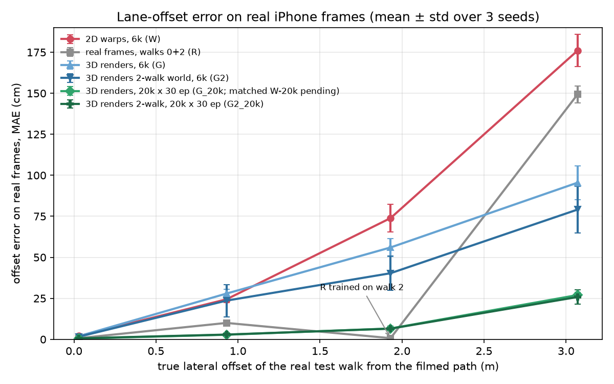
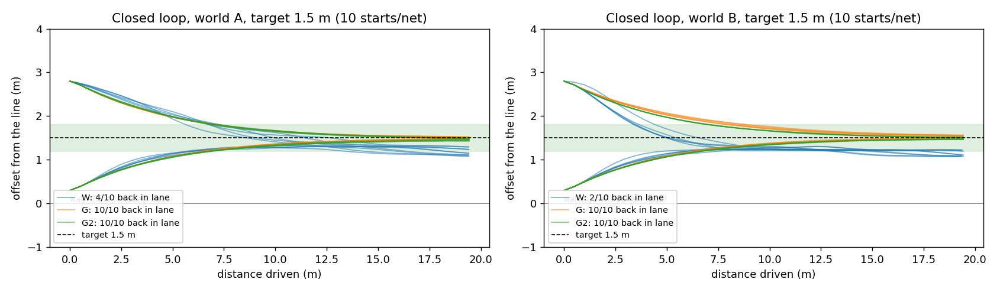

# splat2lane

**Can a lane-keeping network learn views nobody filmed, if it is trained inside a 3D copy of the street built from one phone video?**

On real iPhone footage 3 m to the side of the filmed path, a ResNet-18 trained only on renders of a Gaussian-splat street is off by **25.8 ± 4.4 cm** (G2_20k: world built from walks at 0 and 2 m, 20k renders, 3 seeds). The NVIDIA PilotNet-style baseline trained on 2D image warps of the same footage is off by **176 ± 10 cm**. A splat world built from the 0 m walk alone (G_20k) gets **27.0 ± 1.7 cm**. That one never saw anything filmed off-path. Training on real frames from walks at 0 and 2 m (R) is near-perfect where it was filmed (0.7 cm at 2 m) but fails beyond it (149 ± 5 cm at 3 m).

One confound up front: the 20k-render nets got 3.3x more images and 2x the epochs of the 2D-warp baseline (6k warps, 15 epochs). At equal size (6k renders, 15 epochs), the render nets still beat the warps at 3 m: G 95.5 ± 10.3 cm and G2 79.1 ± 14.2 cm vs W 176 ± 10 cm.

**Private draft.** The 3D viewer link and the public video come after review.

## 3D world and video

- **3D:** `exports/street_all_1080b/splat_yup.ply` (3.03M Gaussians, 751 MB, y-up for SuperSplat). The SuperSplat link will go here after cleanup. Not in git: `*.ply` is ignored.
- **Video (~60 s):** the real walk, then the camera sliding 0 → 3 m sideways in the splat, then the closed loop with the 3D-render net (left) vs the 2D-warp net (right). Faces and plates are blurred. `media/street_in_3d_demo.mp4` (pending, see the status at the end).

## How it works

1. **Filming** ([capture/PROTOCOL.md](capture/PROTOCOL.md)). Robert St, Toronto, Wed 28 Oct. iPhone at 4K 30 fps with exposure, focus and white balance locked and stabilisation off. Four parallel walks at 0, 1, 2 and 3 m from the curb line (plus a slow repeat of walk 0) and a 25 s sidestep sweep that ties them together. COLMAP puts the walks at **0.03 / 0.93 / 1.93 / 3.07 m**.
2. **Camera poses** (`pipeline/s3d_poses.sh`). 878 frames at 3 fps, 2560 wide. `ns-process-data` with vocab-tree matching (16 min) plus COLMAP's incremental mapper (74 min on CPU). **All 878 frames posed.** A single forward walk can't be posed on its own: the triangulation angles are too small, and a 61-frame test clip registered 2 frames. The lateral walks and the sweep are what make the map work. The mapper uses a relaxed start (`pipeline/colmap_relaxed.sh`).
3. **3D worlds** (nerfstudio `splatfacto`, 30k iterations, RTX 3080 10 GB).
   - **World A**: built from the walk-0 frames only (330 train frames, 1440p, 35 min). This is the honest world: walks 1-3 are never seen.
   - **World B**: walks 0 + 2 (457 train frames, 35 min).
   - **Big world**: `splatfacto-big` on all walks at 1080p (45 min), used only for the video and the 3D viewer.
4. **Render quality off the path** (`eval/metrics_by_offset.py`, held-out frames, PSNR in dB):

   | world | w0 (0 m) | w0b (0 m) | w1 (0.93 m) | w2 (1.93 m) | w3 (3.07 m) |
   |---|---|---|---|---|---|
   | A (walk 0) | 23.36 | 24.89 | 20.37 | 18.93 | 17.49 |
   | B (walks 0 + 2) | 23.14 | 24.55 | 22.06 | (train) | 19.47 |

   World A loses ~7 dB from the filmed path to 3 m. Adding a walk at 2 m gains 1.7 dB at the unseen 1 m and 2.0 dB at the unseen 3 m. Overall: A 19.94 dB / SSIM 0.544 / LPIPS 0.453, B 21.59 / 0.611 / 0.402.
5. **Training data for free** (`scripts/render_offsets.py`). Render the world at a random walk-0 position with offset U[0, 3] m and heading U[−10°, 15°], at 480x270. The label is the pose you rendered from: 6,000 views take ~70 s.
6. **Lane net** (`train/train_offset.py`). ImageNet ResNet-18 that regresses (offset, heading) with L1 loss, AdamW and one-cycle LR, 15 epochs (30 for the 20k sets). Every set includes the real walk-0 frames. The sets:
   - **W**: PilotNet-style 2D warps of the real walk-0 frames (`scripts/warp2d.py`). Flat-ground homography below the horizon, rotation only above it, phone height 1.4 m.
   - **G**: renders from world A.
   - **G2**: renders from world B.
   - **R**: real frames from walks 0 + 2 only. The "just film more" reference.
   - **RG2**: R's real frames plus G2's renders, with the real part repeated 4x (see results).
7. **Test on real frames** (`eval/eval_real.py`, `eval/eval_variants.py`). The labels are the COLMAP offsets and headings of every real frame of walks 0-3. Real frames are undistorted to pinhole to match the renders.
8. **Closed loop** (`train/closed_loop.py`, `train/closed_loop_stats.py`), inside the splat. Render, predict, steer (heading change capped at 5° per step), move 0.5 m, repeat. 10 starts per net per world (5 positions along the street × 2 starting offsets) over 20 m. Success = finishing within 30 cm of the target.

## Results

**Offset error on real frames, MAE in cm** (mean ± std over 3 seeds where n = 3; `results/quality_all.csv`):

| net | trained on | n | 0 m | 0.93 m | 1.93 m | 3.07 m |
|---|---|---|---|---|---|---|
| W | 2D warps (6k) | 3 | 2.0 ± 0.5 | 24.4 ± 2.0 | 73.9 ± 8.3 | 176.0 ± 9.8 |
| G | world A renders (6k) | 3 | 1.9 ± 0.2 | 27.9 ± 2.7 | 56.0 ± 5.4 | 95.5 ± 10.3 |
| G2 | world B renders (6k) | 3 | 1.6 ± 0.2 | 23.6 ± 9.8 | 40.3 ± 10.4* | 79.1 ± 14.2 |
| R | real walks 0 + 2 | 3 | 0.7 ± 0.1 | 10.0 ± 1.2 | 0.7 ± 0.1* | 149.3 ± 5.1 |
| **G_20k** | world A renders (20k, 30 ep) | 3 | 0.5 ± 0.1 | 2.8 ± 0.9 | 6.6 ± 0.5 | **27.0 ± 1.7** |
| **G2_20k** | world B renders (20k, 30 ep) | 3 | 0.6 ± 0.1 | 2.9 ± 0.8 | 6.5 ± 1.4* | **25.8 ± 4.4** |
| RG2 | R's real frames + G2 renders (6k) | | pending | | | |
| G_strict | world A from walk-0-only points | 1 | 1.4 | 29.3 | 61.1 | 100.5 |
| G_big | world A, splatfacto-big | 1 | 2.0 | 35.4 | 69.1 | 113.5 |
| G2_big | world B, splatfacto-big | 1 | 1.6 | 28.8 | 49.4 | 88.6 |

\* Not held out: world B and R were trained on walk 2.

**Closed loop** (inside the splat worlds, 10 starts per net per world; `results/closed_loop_summary.csv`, `results/cl_road_summary.csv`):

| target | world | W (2D warps) | G | G2 |
|---|---|---|---|---|
| walk-0 line (0 m) | A | 0/10 (ends 11.9 m away on average) | 10/10 | 10/10 |
| walk-0 line (0 m) | B | 0/10 (12.7 m) | 10/10 | 10/10 |
| in the road (1.5 m) | A | 4/10 | 10/10 | 10/10 |
| in the road (1.5 m) | B | 2/10 | 10/10 | 10/10 |

**Checks:**
- **Strict world** (G_strict). The splat starts from COLMAP points that walks 1-3 also helped triangulate. Rebuilding world A from the 158,781 points seen by at least 2 walk-0 cameras (of 288,801) gives 100.5 cm at 3 m vs 95.5 ± 10.3 cm for G. That's within the seed spread, so no sign of leakage.
- **Bigger splat model** (splatfacto-big at 1440p) did not help the nets (G_big 113.5 cm, G2_big 88.6 cm at 3 m, 1 seed each), even though its held-out PSNR was the same or better.
- **W's phone-height assumption.** W at 1.2 m: 166.2 cm at 3 m. At 1.6 m: 4.0 / 41.8 / 155.3 cm at 1 / 2 / 3 m (1 seed). The warp baseline is sensitive to a number you can't measure from the video.

## Limitations

- **One street, one late morning.** About 50 minutes of filming (11:20 to 12:10). No other weather, light or street.
- **Walking, not driving.** The phone was at chest height (~1.3 m) and moved at walking speed. A car camera sits at a different height and moves faster.
- **Offsets come from COLMAP, not a tape.** The metric scale is fitted so the walk spacing matches the nominal 1/2/3 m (`scripts/lane_common.py`).
- **The closed loop runs inside the splat**, in the same render domain the G nets trained on. That favours G. W's warps never saw render artefacts. The real-frame table is the fair comparison.
- **The 20k nets had more data and epochs than W.** The 6k rows are the like-for-like comparison.
- **The 2-walk world and R saw walk 2**, so their 1.93 m numbers aren't held out (marked \*).
- **Both walk-0 clips point slightly right**, so the splat has less coverage of the left edge. Parked cars may have moved between passes, which is geometry no walk saw consistently.
- **Privacy blur isn't good enough yet.** The video uses OpenCV's bundled Haar face and plate detectors (`scripts/media_blur.py`). The clip has no people in it, but the Haar plate detector misses Ontario plates, and some plates on parked cars are readable at 1080p. A proper plate detector (EgoBlur or a YOLO plate model) has to run before anything goes public.

## Prior art

- **PilotNet** ([NVIDIA, 2020](https://arxiv.org/pdf/2010.08776)) trained steering on off-centre views made by 2D warps under a flat-world assumption. That's baseline W here. It was never compared against 3D renders with real off-path ground truth.
- **HUGSIM** ([2024](https://arxiv.org/abs/2412.01718)) is a closed-loop driving simulator on 3DGS from KITTI-360/Waymo/nuScenes, built on car-rig datasets.
- **RAD** ([Horizon Robotics, 2025](https://arxiv.org/abs/2502.13144)) does RL driving in 3DGS worlds. It needs large multi-camera logs and an RL farm.
- **Para-Lane** ([3DV 2025](https://arxiv.org/abs/2502.15635)) and **EUVS** ([ICCV 2025](https://openaccess.thecvf.com/content/ICCV2025/papers/Han_Extrapolated_Urban_View_Synthesis_Benchmark_ICCV_2025_paper.pdf)) measure how 3DGS degrades when you move sideways, using car-rig data. Here it's a phone, and the question is what the degradation does to a model trained on it.
- **MTGS** ([2025](https://arxiv.org/abs/2503.12552)) shows several traversals improve the 3D model. Here, a second walk at 2 m buys +1.7 to 2.0 dB at the unseen offsets.

## How to reproduce

All scripts run from one flat working directory (copy `scripts/`, `train/` and `eval/` into it) inside the `ghcr.io/nerfstudio-project/nerfstudio` container, run as `docker run --gpus all -u $(id -u) -e HOME=/workspace -e USER=… -e TORCHDYNAMO_DISABLE=1 -v $PWD:/workspace`. The `pipeline/run_*.sh` files are the exact job chains that produced every number here, with cooldowns and temperature logs. The run order:

1. `pipeline/s3d_poses.sh`: frames → poses → splits → worlds A and B.
2. `pipeline/s3d_after.sh`, `pipeline/s3d_bigfresh.sh`: evals and the big world.
3. `pipeline/run_lane.sh`: renders, warps, W/G/G2/R, real test, closed loop.
4. `pipeline/run_extra.sh`, `run_robust.sh`, `run_road.sh`: closed-loop stats, seeds, road target.
5. `pipeline/run_quality.sh`, `run_resume.sh`: strict world, big worlds, 20k renders, seeds.
6. `pipeline/run_final.sh`, `run_media.sh`: video, y-up PLY.
7. `pipeline/run_mix.sh`: RG2.

`results/` holds every CSV behind the tables, plus `results/training_curves/`. `results/SUMMARY.md` is the auto-generated run summary.
